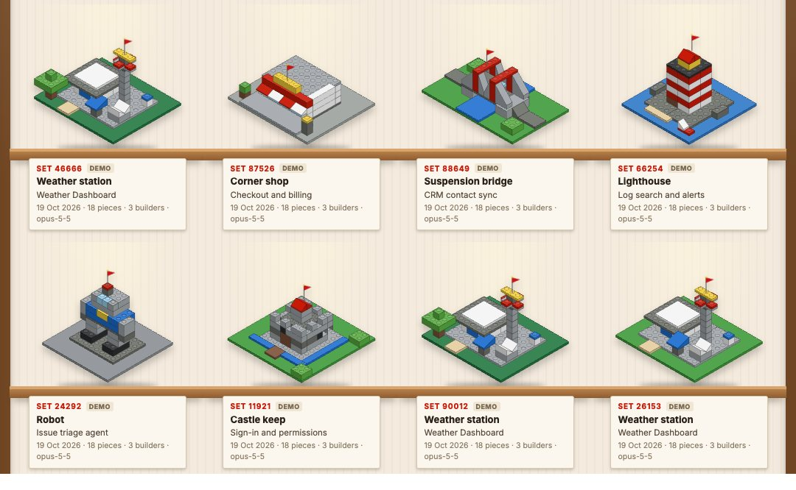
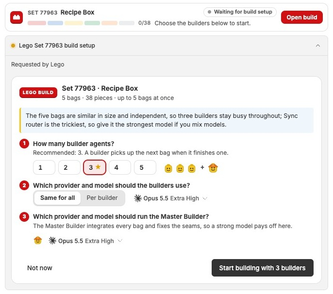
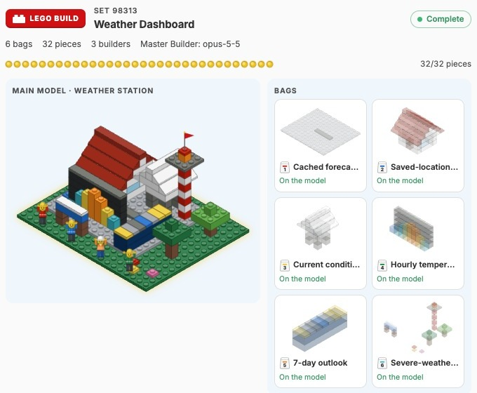
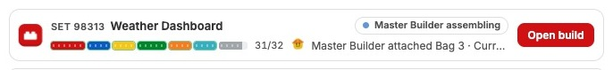
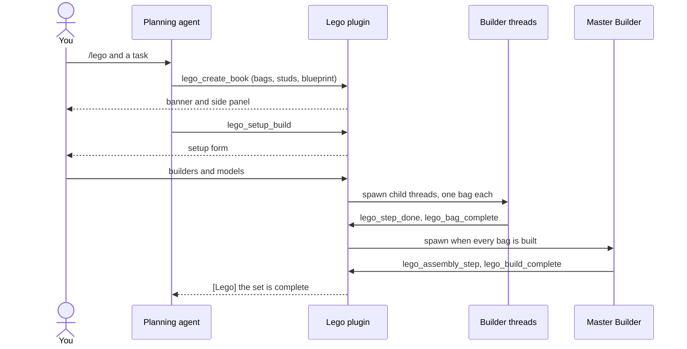

<div align="center">


# Lego

### Build it like Lego: parallel agents, one Master Builder.

Plan a task as an instruction book of bags that builder agents build in parallel.<br>
A Master Builder assembles them while you watch a Lego model of your task come together.


[Features](#features) · [Install](#install) · [Where to find it](#where-to-find-it) · [How it works](#how-it-works) · [CLI](#cli) · [Development](#development)

<br>



</div>

<br>

> [!NOTE]
> The screenshots are real BB captures of fictional tasks. The shelf shows demo builds.

## The problem

A task that touches several parts of a codebase runs one step at a time when
one agent does it all. Splitting it across agents by hand means writing the
briefs, keeping them out of each other's files, and stitching the results
together yourself.

Lego turns the split into an instruction book. The planning agent cuts the task
into bags that can be built at the same time, fixes the shared connection
points up front, and writes the steps a Master Builder follows to assemble the
whole. You choose the crew, and you watch it build.

|  | Without Lego | With Lego |
| --- | :---: | :---: |
| Independent parts built at the same time | ❌ | ✅ one builder thread per bag |
| Shared interfaces fixed before work starts | ❌ | ✅ the book's studs |
| You choose how many agents and which models | ❌ | ✅ a setup form |
| One agent integrates and verifies the result | ❌ | ✅ the Master Builder |
| Progress you can see at a glance | ❌ | ✅ a live Lego model |

## Features

<table>
<tr>
<td width="50%" valign="top">

### 🧱 An instruction book for every task

The planning agent writes bags (sub-assemblies with the files they own and up
to 12 steps), the studs every bag must honour, and the Master Builder's
assembly steps. Up to 12 bags per book.

</td>
<td width="50%" valign="top">

### 👷 Builders in parallel

Each builder is a child thread of yours. When it finishes a bag it picks up
the next one whose dependencies are built, so a crew smaller than the book
still works through it.

</td>
</tr>
<tr>
<td valign="top">

### 🎛️ You staff the crew

A form asks how many builders to use (up to 8), whether they all run the same
provider and model, which model and reasoning level they use, and which model
runs the Master Builder.

</td>
<td valign="top">

### 🏗️ One Master Builder

When every bag is built, the Master Builder attaches them, fixes the seams and
verifies the whole. Your thread gets a message when it finishes, or when a
builder fails or is blocked.

</td>
</tr>
<tr>
<td valign="top">

### 🎨 A model that depicts the task

The planning agent designs the model on the box from walls, towers, roofs,
slopes, trees and bricks. A weather dashboard builds a weather station, and
each part of it is a bag.

</td>
<td valign="top">

### 🏆 A collector's shelf

Every finished model goes on display on the Lego Build page, with a placard
naming its set, the task it was built for, the date and the crew.

</td>
</tr>
</table>

<div align="center">
<table>
<tr>
<td align="center"><br><sub><b>You staff the crew before anything starts</b></sub></td>
<td align="center"><br><sub><b>The workbench in the side panel</b></sub></td>
</tr>
<tr>
<td colspan="2" align="center"><br><sub><b>Live status above the composer</b></sub></td>
</tr>
</table>
</div>

## Install

```sh
bb plugin install git:https://github.com/MacHatter1/bb-plugin-lego --yes
```

Start a new thread and ask for a build with `/lego` and a task.

> [!IMPORTANT]
> The repository is private. Installing from git needs GitHub credentials with
> access to it on the installing machine.

<details>
<summary><b>Install from a local clone</b></summary>

```sh
git clone https://github.com/MacHatter1/bb-plugin-lego
cd bb-plugin-lego
npm install && bb plugin build
bb plugin install path:$PWD --yes
```

</details>

**Requirements**

- bb **0.46+** (Plugin SDK 0.6.49+)
- At least one agent provider set up in BB for the builders and the Master Builder

## Where to find it

| Where | What |
| --- | --- |
| **`/lego` in the composer** | Ask the agent for a Lego build. The bundled skill teaches it to plan the book and design the model. |
| **Setup form** | Replaces the composer while the build is staffed. Nothing starts until you submit it. |
| **Banner above the composer** | Live status: a brick-coloured progress bar per bag, the crew at work, the latest event, and **Open build**. |
| **Side panel → Lego build** | The workbench: the model on its baseplate, a tray per bag with its builder, the instruction pages, the crew with thread links, cancel and retry. |
| **Sidebar → Lego Build** | The collector's shelf of every finished model. Click one to open the thread that built it. |

## How it works



- **Parallel by design.** Bags own disjoint files and code against the studs,
  not against each other. A bag with `dependsOn` waits until those bags are
  built.
- **Ordinary BB threads.** Builders and the Master Builder are child threads of
  the planning thread, in the same workspace, with the provider, model and
  reasoning you chose and the planning thread's permission mode.
- **State that survives restarts.** Books live in the plugin's own SQLite
  database. Thread events missed while the plugin was unloaded are reconciled
  every minute.
- **No bag passes for built unless it is.** A builder that cannot build its
  bag says so with `lego_bag_blocked`. One that stops short is asked once to
  report; if it stops short again, the bag fails and the planning thread gets
  the builder's own words. The Master Builder is held to the same rule. A
  thread BB refuses to start under load (a 5xx, or a dispatch hook timing out)
  is retried twice before the bag fails.
- **Blueprints, checked.** A blueprint compiles into at most 220 bricks on a
  baseplate of 6 to 24 studs a side. Bricks off the plate or colliding with
  earlier ones are dropped and reported back to the planning agent. Books
  without a blueprint use one of eight ready-made models, matched from the
  title and task.

## Safe by default

- 🧑‍✈️ **You pick the crew.** No builder starts until you submit the setup form. Closing it starts nothing.
- 📁 **Builders stay in your workspace.** They edit files in the planning thread's workspace, each in the files its bag owns, and are told not to commit, push or open pull requests.
- 🛑 **Stop at any time.** **Cancel build** in the panel, `lego_cancel_build` or `bb lego cancel` stops every worker thread. Files they already changed stay.
- 🔒 **Nothing leaves BB.** Books are stored in the plugin's own database. The plugin calls no external service.
- 🧪 **Demos spawn nothing.** `bb lego demo` runs simulated builders in the plugin, with no agent threads.

## CLI

```sh
bb lego list                       # this thread's books
bb lego status lb_7c1e2a9f04       # bags, builders, Master Builder, latest events
bb lego demo                       # print a sample book; press Play on its banner
```

```text
$ bb lego list
lb_7c1e2a9f04  Set 48213 "Billing dashboard"  building  12/31 pieces
```

<details>
<summary><b>All commands</b></summary>

| Command | Does |
| --- | --- |
| `list [--all] [--json]` | Books for this thread, or every thread with `--all`. |
| `status <bookId> [--json]` | One book's bags, builders, Master Builder and latest events. |
| `cancel <bookId>` | Cancel a build and stop its worker threads. |
| `retry <bookId> [--bag <bagId>]` | Retry failed bags, or one bag, and a failed Master Builder. |
| `demo [--model <name>] [--builders 1-4] [--autoplay [--delay 3s]]` | Print a sample book in this thread. Press **Play demo** on its banner, or pass `--autoplay`. |
| `step <number> [--note …]` | Builder fallback: report a finished step. |
| `bag-done --summary …` | Builder fallback: report the bag is built. |
| `blocked --reason …` | Builder fallback: report the bag cannot be built, and why. |
| `assembled <number> [--note …]` | Master Builder fallback: report an assembly step. |
| `complete --summary …` | Master Builder fallback: report the model is complete. |

</details>

**Agent tools:** `lego_create_book({ title, task, studs, bags, assembly, blueprint })`,
`lego_setup_build({ bookId })`, `lego_status`, `lego_cancel_build` and `lego_retry`
for the planning agent; `lego_step_done`, `lego_bag_complete` and `lego_bag_blocked` for builders;
`lego_assembly_step` and `lego_build_complete` for the Master Builder. Each
thread sees only its own set. The bundled [skill](skills/lego/SKILL.md) teaches
the planning agent to cut a task into parallel bags and to design a blueprint
for the model on the box.

## Development

```sh
npm install
npm test
npm run typecheck
bb plugin build
bb plugin install path:$PWD --yes
bb plugin dev                      # rebuild and reload on every save
LEGO_PREVIEW=$TMPDIR/lego.html npx vitest run scripts   # render every model to one page
```

```
server.ts         RPC, agent tools, CLI, thread events and the reconcile service
app.tsx           registers the banner, side panel, setup form, shelf page and chip
src/book.ts       book schema and state types
src/plan.ts       turns a book spec into a book, with dependency checks
src/engine.ts     the scheduler: bags to builders, the Master Builder, failures
src/store.ts      SQLite storage
src/prompts.ts    builder and Master Builder prompts
src/designs.ts    ready-made models, bag layout and paint order
src/blueprint.ts  blueprint shapes and compiler
src/demo.ts       simulated demo builds
src/ui/           banner, panel, setup form, shelf, isometric renderer, minifigures
components/ui/    vendored UI components
skills/lego/      the bundled agent skill
test/             engine, design and blueprint tests
scripts/          the static model preview
docs/             logo and screenshots
```

**Tests** run the scheduler against a fake SDK and an in-memory SQLite
database (parallel bags, builder reuse, dependencies, failures, blocked and
stalled builders, dispatch retries, user retries and
cancelling), check every ready-made model for overlapping bricks, bricks off
the baseplate, paint order and bag splits, and cover the blueprint compiler and
model matching.

`PLUGIN_OVERVIEW.md` is the store listing. Keep it in step with
`bb.description` in `package.json`.

## Licence

[MIT](LICENSE)
